<p align="center">
  <picture>
    <source media="(max-width: 600px) and (prefers-color-scheme: dark)" srcset="assets/hero-mobile-dark.svg">
    <source media="(max-width: 600px)" srcset="assets/hero-mobile-light.svg">
    <source media="(prefers-color-scheme: dark)" srcset="assets/hero-dark.svg">
    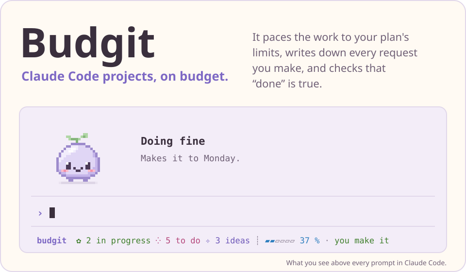
  </picture>
</p>

<p align="center">
  
  
  
  
  
</p>

<p align="center">
  <a href="#install">Install</a> · <a href="#what-budgit-creates">What it creates</a> · <a href="#how-it-works">How it works</a> · <a href="#use-it-well">Use it well</a> · <a href="#a-week-with-budgit">A week</a> · <a href="#brote">Brote</a> · <a href="#make-it-yours">Make it yours</a> · <a href="#guards">Guards</a> · <a href="#commands">Commands</a> · <a href="#updates">Updates</a> · <a href="#faq">FAQ</a> · <a href="../../wiki">Wiki</a>
</p>

## What it is

<p align="center"><b>A Claude Code plugin that runs your project in phases, from the first idea to the launch.</b><br>It paces the work to your plan, writes down every request, and has a fresh reviewer test each piece.</p>

<p align="center">
  <picture>
    <source media="(max-width: 600px) and (prefers-color-scheme: dark)" srcset="assets/compare-mobile-dark.svg">
    <source media="(max-width: 600px)" srcset="assets/compare-mobile-light.svg">
    <source media="(prefers-color-scheme: dark)" srcset="assets/compare-dark.svg">
    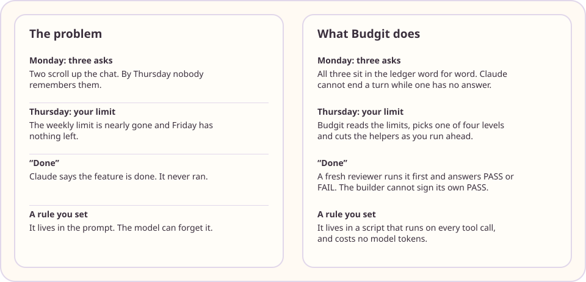
  </picture>
</p>

<p align="center">
  <picture>
    <source media="(max-width: 600px) and (prefers-color-scheme: dark)" srcset="assets/parts-mobile-dark.svg">
    <source media="(max-width: 600px)" srcset="assets/parts-mobile-light.svg">
    <source media="(prefers-color-scheme: dark)" srcset="assets/parts-dark.svg">
    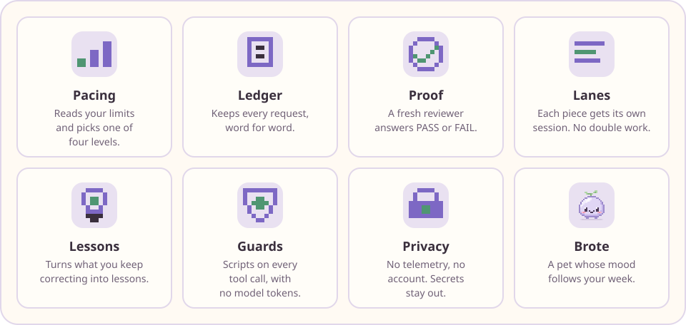
  </picture>
</p>

## Install

<p align="center">
  <picture>
    <source media="(max-width: 600px) and (prefers-color-scheme: dark)" srcset="assets/install-mobile-dark.svg">
    <source media="(max-width: 600px)" srcset="assets/install-mobile-light.svg">
    <source media="(prefers-color-scheme: dark)" srcset="assets/install-dark.svg">
    
  </picture>
</p>

> The Claude desktop app's Cowork and Customize > Plugins screens cannot install Budgit. Install it from Claude Code with `/plugin install budgit --marketplace suraei/budgit`, or from a shell with `claude plugin marketplace add suraei/budgit` then `claude plugin install budgit@budgit-hub`.

```
/plugin install budgit --marketplace suraei/budgit
```

Claude Code 2.1.292+ and Python 3. [Getting started](../../wiki/Getting-started) has the rest.

## What Budgit creates

Three folders, all yours. Your requests stay out of git unless you choose.

<p align="center">
  <picture>
    <source media="(max-width: 600px) and (prefers-color-scheme: dark)" srcset="assets/folders-mobile-dark.svg">
    <source media="(max-width: 600px)" srcset="assets/folders-mobile-light.svg">
    <source media="(prefers-color-scheme: dark)" srcset="assets/folders-dark.svg">
    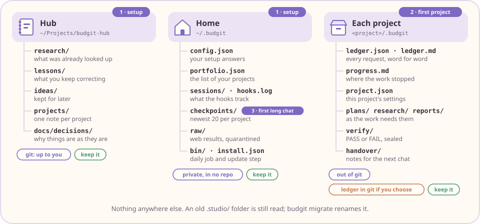
  </picture>
</p>

[Folders and files](../../wiki/Folders-and-files) lists every file, whether it is in git, and what is safe to delete.

## How it works

### One request, from prompt to release

<p align="center">
  <picture>
    <source media="(max-width: 600px) and (prefers-color-scheme: dark)" srcset="assets/flow2-mobile-dark.svg">
    <source media="(max-width: 600px)" srcset="assets/flow2-mobile-light.svg">
    <source media="(prefers-color-scheme: dark)" srcset="assets/flow2-dark.svg">
    
  </picture>
</p>

A FAIL is normal: the work goes back to build until a fresh reviewer passes it.

### Seven phases, one approval each

<p align="center">
  <picture>
    <source media="(max-width: 600px) and (prefers-color-scheme: dark)" srcset="assets/phases2-mobile-dark.svg">
    <source media="(max-width: 600px)" srcset="assets/phases2-mobile-light.svg">
    <source media="(prefers-color-scheme: dark)" srcset="assets/phases2-dark.svg">
    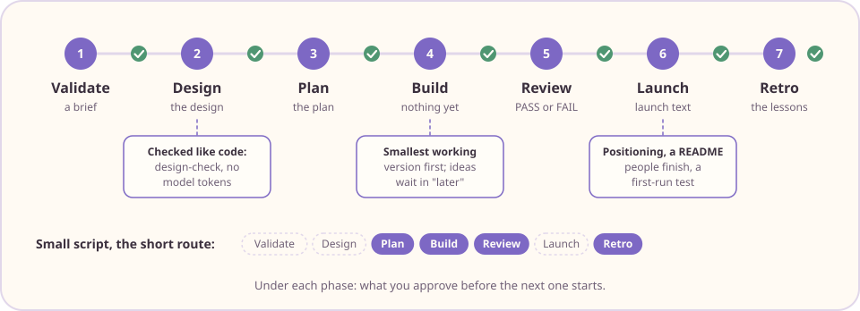
  </picture>
</p>

## Use it well

<p align="center">
  <picture>
    <source media="(max-width: 600px) and (prefers-color-scheme: dark)" srcset="assets/habits-mobile-dark.svg">
    <source media="(max-width: 600px)" srcset="assets/habits-mobile-light.svg">
    <source media="(prefers-color-scheme: dark)" srcset="assets/habits-dark.svg">
    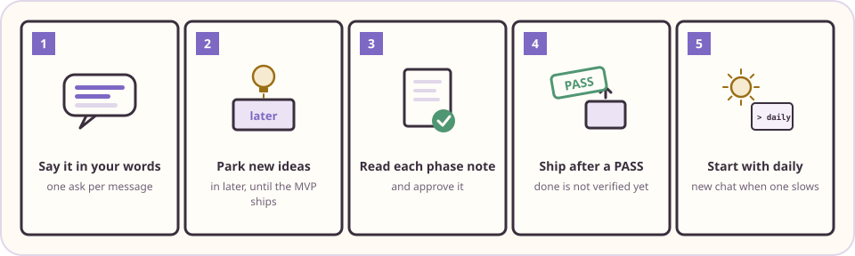
  </picture>
</p>

[Using Budgit well](../../wiki/Using-Budgit-well) has each habit with an example.

### Task management

<p align="center">
  <picture>
    <source media="(max-width: 600px) and (prefers-color-scheme: dark)" srcset="assets/board-mobile-dark.svg">
    <source media="(max-width: 600px)" srcset="assets/board-mobile-light.svg">
    <source media="(prefers-color-scheme: dark)" srcset="assets/board-dark.svg">
    
  </picture>
</p>

Every ask becomes a card. It is finished only when a fresh reviewer passes it. [Task management](../../wiki/Task-management) has every command.

### Skills and helpers, phase by phase

<p align="center">
  <picture>
    <source media="(max-width: 600px) and (prefers-color-scheme: dark)" srcset="assets/skills-mobile-dark.svg">
    <source media="(max-width: 600px)" srcset="assets/skills-mobile-light.svg">
    <source media="(prefers-color-scheme: dark)" srcset="assets/skills-dark.svg">
    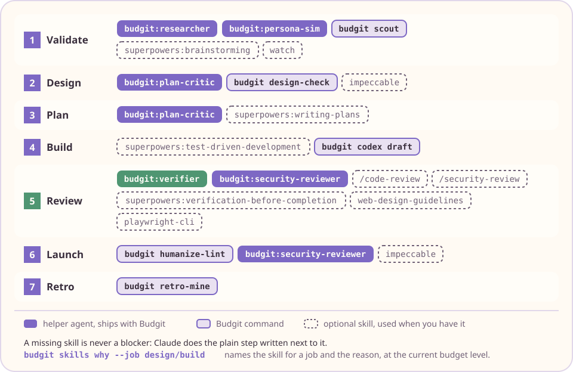
  </picture>
</p>

Seven helper agents ship with Budgit, each starting fresh. A missing skill has a plain fallback. [Skills workflow](../../wiki/Skills-workflow)

### Light context: skills load only when needed

<p align="center">
  <picture>
    <source media="(max-width: 600px) and (prefers-color-scheme: dark)" srcset="assets/context-mobile-dark.svg">
    <source media="(max-width: 600px)" srcset="assets/context-mobile-light.svg">
    <source media="(prefers-color-scheme: dark)" srcset="assets/context-dark.svg">
    
  </picture>
</p>

`budgit skills load-plan` shows which skills could load by name only. It prints; it never writes.

## A week with Budgit

<p align="center">
  <picture>
    <source media="(max-width: 600px) and (prefers-color-scheme: dark)" srcset="assets/chart-mobile-dark.svg">
    <source media="(max-width: 600px)" srcset="assets/chart-mobile-light.svg">
    <source media="(prefers-color-scheme: dark)" srcset="assets/chart-dark.svg">
    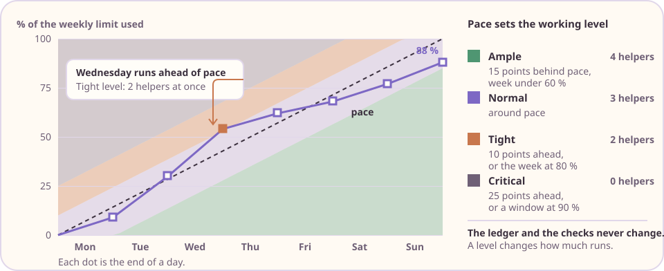
  </picture>
</p>

<p align="center">
  <picture>
    <source media="(max-width: 600px) and (prefers-color-scheme: dark)" srcset="assets/pacing-mobile-dark.svg">
    <source media="(max-width: 600px)" srcset="assets/pacing-mobile-light.svg">
    <source media="(prefers-color-scheme: dark)" srcset="assets/pacing-dark.svg">
    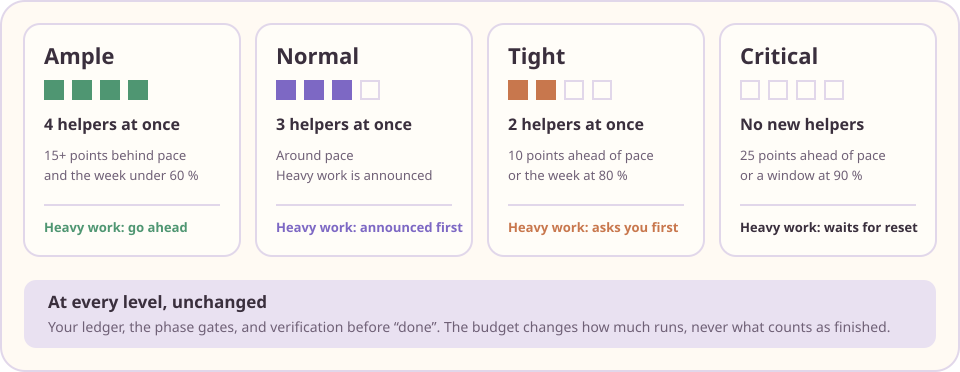
  </picture>
</p>

`budgit budget` shows the numbers. `budgit budget set tight` and `budgit budget auto` change the level.

## Brote

A small pet whose mood is your week. He lives above your prompt, and on macOS in his own window.

<p align="center">
  <picture>
    <source media="(max-width: 600px) and (prefers-color-scheme: dark)" srcset="assets/week-mobile-dark.svg">
    <source media="(max-width: 600px)" srcset="assets/week-mobile-light.svg">
    <source media="(prefers-color-scheme: dark)" srcset="assets/week-dark.svg">
    
  </picture>
</p>

<p align="center">
  <picture>
    <source media="(max-width: 600px) and (prefers-color-scheme: dark)" srcset="assets/brote-mobile-dark.svg">
    <source media="(max-width: 600px)" srcset="assets/brote-mobile-light.svg">
    <source media="(prefers-color-scheme: dark)" srcset="assets/brote-dark.svg">
    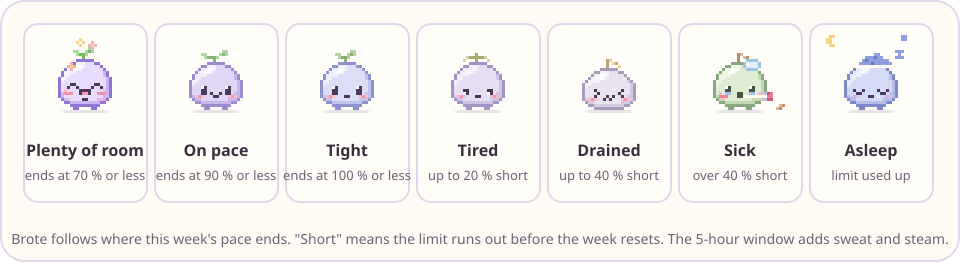
  </picture>
</p>

<p align="center">
  <picture>
    <source media="(max-width: 600px) and (prefers-color-scheme: dark)" srcset="assets/brote-moves-mobile-dark.svg">
    <source media="(max-width: 600px)" srcset="assets/brote-moves-mobile-light.svg">
    <source media="(prefers-color-scheme: dark)" srcset="assets/brote-moves-dark.svg">
    
  </picture>
</p>

<p align="center">
  <picture>
    <source media="(max-width: 600px) and (prefers-color-scheme: dark)" srcset="assets/where-mobile-dark.svg">
    <source media="(max-width: 600px)" srcset="assets/where-mobile-light.svg">
    <source media="(prefers-color-scheme: dark)" srcset="assets/where-dark.svg">
    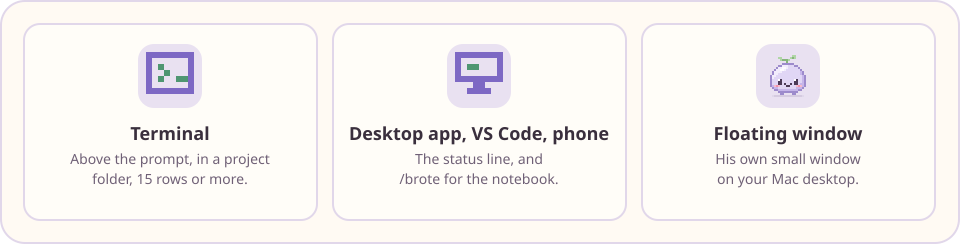
  </picture>
</p>

<p align="center">
  
</p>

**Floating window (macOS):** `/budgit-brote on` brings him back and `/budgit-brote off` closes him. The floating window runs on macOS only.

> [!NOTE]
> **Known issue.** If you drop Brote by hand at the very moment your Mac slides to another Space, he can still run to a corner once. A live switch between two Spaces has not been tested on a real Mac yet.

The [Brote page](../../wiki/Brote) has the rest, and the [animation bank](../../wiki/Brote-animation-bank) shows every animation and what makes it play.

## Make it yours

<p align="center">
  <picture>
    <source media="(max-width: 600px) and (prefers-color-scheme: dark)" srcset="assets/settings-mobile-dark.svg">
    <source media="(max-width: 600px)" srcset="assets/settings-mobile-light.svg">
    <source media="(prefers-color-scheme: dark)" srcset="assets/settings-dark.svg">
    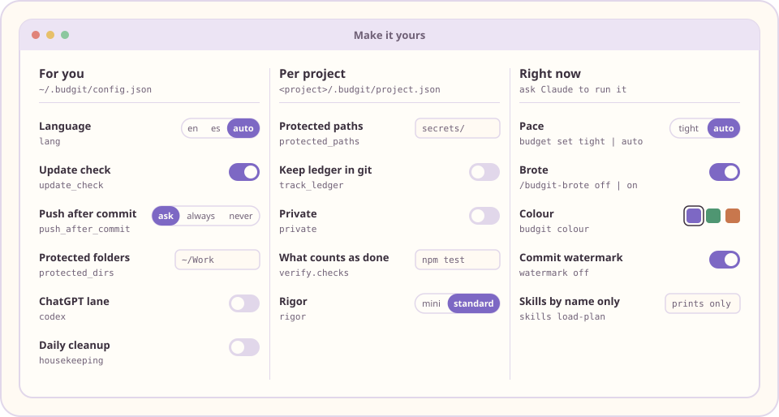
  </picture>
</p>

[Customise](../../wiki/Customise) lists every key, its values and its default.

## Guards

<p align="center">
  <picture>
    <source media="(max-width: 600px) and (prefers-color-scheme: dark)" srcset="assets/guard-mobile-dark.svg">
    <source media="(max-width: 600px)" srcset="assets/guard-mobile-light.svg">
    <source media="(prefers-color-scheme: dark)" srcset="assets/guard-dark.svg">
    
  </picture>
</p>

Scripts, not prompts: no model tokens, and they hold when the model forgets a rule.

## Your data stays yours

<p align="center">
  <picture>
    <source media="(max-width: 600px) and (prefers-color-scheme: dark)" srcset="assets/data-mobile-dark.svg">
    <source media="(max-width: 600px)" srcset="assets/data-mobile-light.svg">
    <source media="(prefers-color-scheme: dark)" srcset="assets/data-dark.svg">
    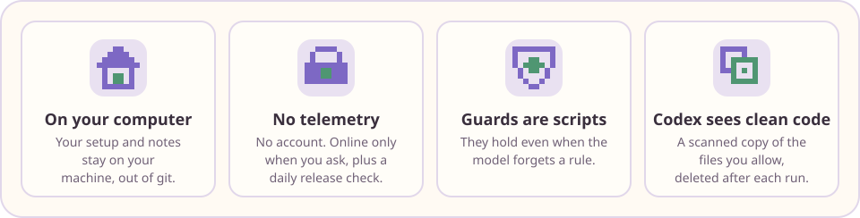
  </picture>
</p>

Guards stop accidents and hostile repo files, not a determined agent. [Privacy and security](../../wiki/Privacy-and-security)

## Commands

Claude runs these as you talk. To run one yourself, ask Claude.

<p align="center">
  <picture>
    <source media="(max-width: 600px) and (prefers-color-scheme: dark)" srcset="assets/commands-mobile-dark.svg">
    <source media="(max-width: 600px)" srcset="assets/commands-mobile-light.svg">
    <source media="(prefers-color-scheme: dark)" srcset="assets/commands-dark.svg">
    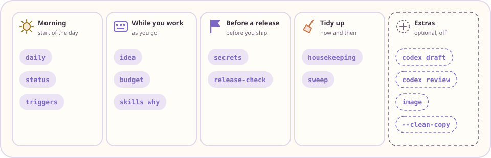
  </picture>
</p>

[Commands](../../wiki/Commands) lists all of them and the seven helper agents.

## Updates

<p align="center">
  <picture>
    <source media="(max-width: 600px) and (prefers-color-scheme: dark)" srcset="assets/update-mobile-dark.svg">
    <source media="(max-width: 600px)" srcset="assets/update-mobile-light.svg">
    <source media="(prefers-color-scheme: dark)" srcset="assets/update-dark.svg">
    
  </picture>
</p>

To update, one prompt is enough, in any Claude chat: ask Claude to update Budgit. It runs `claude plugin marketplace update budgit-hub`, then `claude plugin update budgit@budgit-hub`, and reports the version. Your next chat uses it.

Keep-alive and away mode («me voy») are on by default; switch them off with `budgit setup --answer keepalive=no` and `budgit setup --answer away=no`. After an update, Budgit asks once about the lead and team structure, the daily cleanup and a morning stand-up at 08:00; the last two stay off without your yes. The team rules are on by default (`budgit rules off <topic>`).

To switch the daily check off: `"update_check": "off"` in `~/.budgit/config.json`. [Getting started](../../wiki/Getting-started) has the rest.

## FAQ

Tap a question to open the answer. The short answer is already next to it.

### Cost and limits

<details><summary><b>Does it cost extra?</b> → <b>No.</b></summary><p>Budgit is free and MIT licensed. The helper agents use your Claude plan, and the budget level decides how many run at once.<br><sub>Depth: <a href="../../wiki/FAQ">FAQ</a></sub></p></details>
<details><summary><b>Do I need ChatGPT?</b> → <b>No.</b></summary><p>The ChatGPT lane ships off.<br><sub>Depth: <a href="../../wiki/How-Budgit-works">How Budgit works</a></sub></p></details>
<details><summary><b>What if I run over my limit?</b> → <b>It slows down first.</b></summary><p>Budgit slows down before that. It cannot raise your plan's limit.<br><sub>Depth: <a href="../../wiki/FAQ">FAQ</a></sub></p></details>

### Control and updates

<details><summary><b>Can I turn a guard off?</b> → <b>Most of them.</b></summary><p>Most of them, yes. Two have no switch on purpose: only the verifier writes PASS reports, and only the quarantined reader sees raw web results.<br><sub>Depth: <a href="../../wiki/Privacy-and-security">Privacy and security</a></sub></p></details>
<details><summary><b>Can I use it with one model or one session?</b> → <b>Yes.</b></summary><p>That model fills every helper role, and the rules stay the same.<br><sub>Depth: <a href="../../wiki/FAQ">FAQ</a></sub></p></details>
<details><summary><b>Will it update by itself?</b> → <b>No.</b></summary><p>It tells you when a new version is out. You choose when to update.<br><sub>Depth: <a href="../../wiki/Getting-started">Getting started</a></sub></p></details>

### Where it runs

<details><summary><b>Does it run on Linux or Windows?</b> → <b>macOS only, for now.</b></summary><p>It is tested on macOS. Linux is untested and may work. Windows is not supported yet.<br><sub>Depth: <a href="../../wiki/FAQ">FAQ</a> · what is planned is in the <a href="#roadmap">Roadmap</a> below</sub></p></details>
<details><summary><b>Which language does it speak?</b> → <b>Yours.</b></summary><p>It follows your Claude Code language.<br><sub>Depth: <a href="../../wiki/FAQ">FAQ</a></sub></p></details>

More questions and longer answers: [FAQ](../../wiki/FAQ) in the wiki.

## Roadmap

<p align="center">
  <picture>
    <source media="(max-width: 600px) and (prefers-color-scheme: dark)" srcset="assets/roadmap-mobile-dark.svg">
    <source media="(max-width: 600px)" srcset="assets/roadmap-mobile-light.svg">
    <source media="(prefers-color-scheme: dark)" srcset="assets/roadmap-dark.svg">
    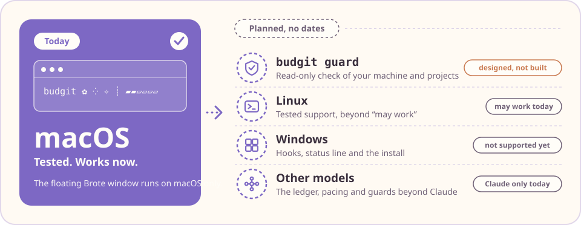
  </picture>
</p>

<p align="center"><b>Today:</b> macOS &nbsp;·&nbsp; <b>Next, no dates:</b> <code>budgit guard</code> · Linux · Windows · other models</p>

## Learn more

<p align="center">
  <picture>
    <source media="(max-width: 600px) and (prefers-color-scheme: dark)" srcset="assets/wikimap-mobile-dark.svg">
    <source media="(max-width: 600px)" srcset="assets/wikimap-mobile-light.svg">
    <source media="(prefers-color-scheme: dark)" srcset="assets/wikimap-dark.svg">
    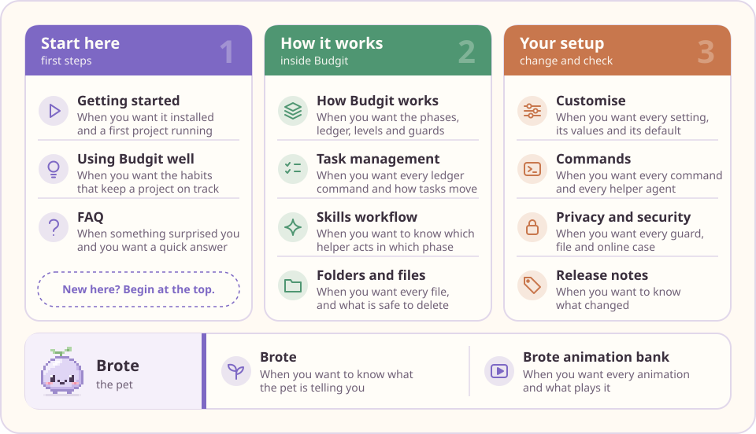
  </picture>
</p>

<p align="center">
  <b>Start here</b> &nbsp;<a href="../../wiki/Getting-started">Getting started</a> · <a href="../../wiki/Using-Budgit-well">Using Budgit well</a> · <a href="../../wiki/FAQ">FAQ</a><br>
  <b>How it works</b> &nbsp;<a href="../../wiki/How-Budgit-works">How Budgit works</a> · <a href="../../wiki/Task-management">Task management</a> · <a href="../../wiki/Skills-workflow">Skills workflow</a> · <a href="../../wiki/Folders-and-files">Folders and files</a><br>
  <b>Your setup</b> &nbsp;<a href="../../wiki/Customise">Customise</a> · <a href="../../wiki/Commands">Commands</a> · <a href="../../wiki/Privacy-and-security">Privacy and security</a> · <a href="../../wiki/Release-notes">Release notes</a><br>
  <b>Brote</b> &nbsp;<a href="../../wiki/Brote">Brote</a> · <a href="../../wiki/Brote-animation-bank">Brote animation bank</a>
</p>

MIT licensed. See [LICENSE](LICENSE).
