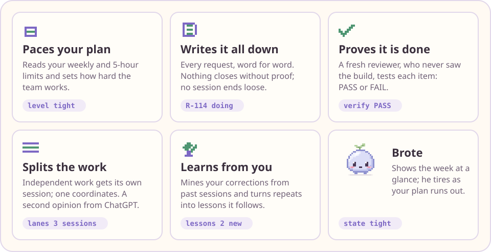

<p align="center">
  <picture>
    <source media="(prefers-color-scheme: dark)" srcset="assets/hero-dark.svg">
    
  </picture>
</p>

<p align="center">
  <a href="#get-started">Get started</a> · <a href="#what-you-get">What you get</a> · <a href="#brote">Brote</a> · <a href="#guards-you-will-meet">Guards</a> · <a href="#commands">Commands</a> · <a href="#privacy">Privacy</a> · <a href="https://github.com/suraei/budgit/wiki">Wiki</a>
</p>

<p align="center"><sub>version 0.13.0 · Claude Code 2.1.292 or newer · Python 3 · tested on macOS · speaks English and Spanish</sub></p>

## Why Budgit

You ask Claude Code for three things on Monday. By Thursday two of them are lost somewhere up the chat, your weekly limit is nearly spent, and the feature Claude called "done" has never run.

Budgit is a Claude Code plugin that takes a project from idea to finished, in phases, and keeps those three problems away. It writes down every request you make, paces the work to your plan's limits, and sends a fresh reviewer to test each piece before it counts as done. A small pixel pet called Brote sits above your prompt and shows you how the week is going.

Budgit talks to you in your own language. It follows your Claude Code language setting, falls back to your computer's language, and ships with English and Spanish.

## What you get

<p align="center">
  <picture>
    <source media="(prefers-color-scheme: dark)" srcset="assets/rails-dark.svg">
    
  </picture>
</p>

- **Your week lasts.** Budgit reads your weekly and 5-hour limits and picks one of four working levels: ample, normal, tight or critical. The level decides how many helper agents run at once and how much each one may do.
- **Nothing you ask gets lost.** Every request goes into a ledger, word for word, with a status. Claude cannot end a turn while a request sits unanswered.
- **"Done" means tested.** A reviewer that never saw the build tries to break it and answers PASS or FAIL. The agent that built the item cannot write its own PASS.
- **Big jobs split cleanly.** Independent pieces of work get their own Claude Code session while one session coordinates, and two sessions never build the same item.
- **It learns your taste.** `budgit retro-mine` reads your past sessions on your machine, finds what you keep correcting, and turns the repeats into lessons Claude follows next time.

The guards are plain scripts, so they cost no model tokens and hold even when the model forgets a rule. You choose which ones to loosen, and anything risky asks you first.

## Get started

**0. Get Claude Code.** Budgit is a plugin for Claude Code, so Claude Code comes first.

- **A plan that includes it.** Claude Code needs a Claude Pro, Max, Team or Enterprise plan, or a Console account. The free plan does not include it. Claude's chat and Cowork cannot install Budgit, because it ships its own `budgit` command, so add it through Claude Code as below, not under **Customize → Plugins** in the Claude app.
- **The Claude Code terminal app.** On macOS, in the Terminal:

  ```bash
  curl -fsSL https://claude.ai/install.sh | bash
  ```

  Or with Homebrew: `brew install --cask claude-code`. Then open a new Terminal window and check that it answers:

  ```bash
  claude --version
  ```

  It must print 2.1.292 or newer. You add Budgit with this app even if you then work in the Claude desktop app's **Code** tab or in VS Code. All three read the same settings.
- **Python 3.** `python3 --version` must print `Python 3.x`. If it does not, run `xcode-select --install` on macOS.

Budgit is not in Anthropic's official marketplace or its plugin directory, so a search there will not find it. You add it once by its GitHub name, `suraei/budgit`.

**1. Install the plugin.** Pick one way.

*Ask Claude.* In any Claude Code chat, the terminal or the desktop app's Code tab, paste:

> Install the Budgit plugin: run `claude plugin marketplace add suraei/budgit` and `claude plugin install budgit@budgit-hub`, then tell me to run /reload-plugins.

This works when `claude --version` answers in your Terminal, because Claude runs that same terminal app for you. The desktop app's own built-in copy is not one Claude can run. If you only have the desktop app, do step 0 first.

*Type it in a terminal session.* Start Claude Code with `claude`, then type this at its prompt, not at the shell prompt:

```
/plugin install budgit --marketplace suraei/budgit
```

It asks you to confirm adding the marketplace, then shows Budgit's details. Choose **Install for you**.

*From your shell, without a session:*

```bash
claude plugin install budgit --marketplace suraei/budgit
```

It adds the `budgit-hub` marketplace and prints `Successfully installed plugin: budgit@budgit-hub`.

*In VS Code.* Type `/plugins` in the Claude Code panel. Add `suraei/budgit` on the **Marketplaces** tab, then install Budgit from the **Plugins** tab.

*The Claude desktop app* does not run the `/plugin` commands in its Code tab. Use one of the ways above once, and Budgit shows up there too.

**2. Reload Claude Code.** Type `/reload-plugins` in an open session, or start a new one.

**3. Tell Claude what you want to build.** For example: *"I have an idea: a small app to plan meals for the week."* The first time, Claude asks you up to four setup questions:

1. Your GitHub account, so your commits use its private noreply address.
2. A folder for your hub, where ideas, research and lessons live.
3. A folder for your projects.
4. Whether to turn on the optional ChatGPT lane.

Then it creates the project, writes your idea as the first ledger item and starts the first phase. Every step that stops tells you the next one.

> **If Claude cannot use any tool after you install,** Python is almost certainly missing. The guards cannot start, and to stay safe they block everything. Turn the plugin off from the Terminal (not from Claude) with
> `claude plugin disable budgit@budgit-hub`, install Python, then turn it back on with `claude plugin enable budgit@budgit-hub`.

**If the install does not work:**

| You see | What to do |
| --- | --- |
| `claude: command not found` | The Claude Code terminal app is not installed, or not on your PATH yet. Do step 0, then open a new Terminal window. |
| `no such file or directory: /plugin` | You typed `/plugin` at the shell prompt. Start `claude` first and type it there, or use the `claude plugin …` commands. |
| `/plugin isn't available in this environment` | You are in the desktop app's Code tab or in VS Code. Ask Claude, or use the steps for that place above. |
| `Unknown command: /plugin`, or a `claude plugin` error about an unknown command | Your Claude Code is too old. Run `claude update` (with Homebrew, `brew upgrade claude-code`), then check `claude --version`. |
| `Plugin "budgit" not found` | The marketplace is not added yet. Use the `--marketplace suraei/budgit` form above, or run `claude plugin marketplace add suraei/budgit` first. |

Windows is not supported and the install there is untested. The [FAQ](https://github.com/suraei/budgit/wiki/FAQ) has more answers.

## How a project moves

A project goes through seven phases: **validate, design, plan, build, review, launch, retro**. Each phase ends with a short document you approve before the next one starts. A small script takes the short route (plan, build, review, retro). An app or a game walks the whole road.

- **The smallest working version comes first.** Each project names early the smallest version that works end to end. New ideas wait in a "later" list.
- **Design gets checked like code.** Visual work passes deterministic design checks (`budgit design-check`, no model tokens) and a written rubric before you see it.
- **Launch is part of the job.** The launch phase helps with positioning, a README people finish, and a first-run test.

Budgit works the same with one session and one model. With a plan that has only one model, that model fills every agent role and the rules stay the same.

## Brote

Brote lives above your prompt and tells you, at a glance, how your week is going. His health follows your projected weekly use. When the 5-hour window runs hot, he sweats, then steams.

<p align="center">
  <picture>
    <source media="(prefers-color-scheme: dark)" srcset="assets/brote-dark.svg">
    
  </picture>
</p>

- **Click him**, or type `/brote`, to open the notebook: what is in progress (stalled items first), what is next, what waits for later.
- **Drag him around** the band. Click him four times in a row and he gets grumpy. `/brote still` stops his animation.
- **Stalled items** (nobody touched them for a week) make Brote point at the notebook.

The status line under the prompt sums it all up in one row. When your week will run out early, the end shows the day and hour instead, such as `ends Fri 18h`.

```
budgit  ✿ 2 in progress ⁘ 5 to do ✧ 3 ideas ┊ ▰▰▱▱▱▱ 37 % · you make it
```

| Where | What you see |
| --- | --- |
| Terminal and desktop app | Brote above the prompt when the window has at least 15 rows. Below that, a text line and a **Notebook** button. |
| VS Code and mobile | The status line and `/brote` for the notebook. |
| Floating window (experimental, macOS) | Brote in his own small window on your desktop, with a book he carries and a notebook panel. You build it from source in `experimental/brote-float/`; read its README first. |

Every animation, with a preview and what makes it play, is in the [Brote animation bank](https://github.com/suraei/budgit/wiki/Brote-animation-bank) on the wiki.

## Guards you will meet

Each guard either asks you or says no. The table says what each one stops, why, and how to turn it off.

| Guard | What it stops, and why | Turn it off |
| --- | --- | --- |
| Commit identity | A commit to a GitHub repo signed with a real email address. Keeps your private address out of public history. | Set a noreply address: `git config user.email <id>+<login>@users.noreply.github.com` |
| Protected paths | Writes to the files you list in `protected_paths` (asks). Your real data stays untouched. | Edit the list in `.budgit/project.json` |
| Verifier reports | Anyone but the reviewer writing `.budgit/verify/`, which would forge a PASS. | No switch. This is the point. |
| Scout quarantine | Reading raw web results directly. Text from the web can carry instructions. | No switch. Only `budgit:scout-reader` reads them. |
| Hook bypass | `git commit --no-verify` and similar (asks). Skipped hooks hide problems. | Answer yes when you mean it |
| Contract lock | Weakening the checks that define "done" (asks). Nobody loosens a test to turn red into green. | Answer yes when you mean it |
| Ledger check | Ending a turn with a request unanswered. | Answer it with `budgit ledger add --text "…"`, or set a remark aside with `budgit ledger ack I-n --note "why"` |
| Push reminder | Nothing. It reminds you about unpushed work. | `budgit setup --force --push-after-commit never` (default `ask`: Claude asks before it pushes) |

To switch everything off for a while, run `claude plugin disable budgit@budgit-hub`.

## Commands

Claude runs these for you as you talk. The `budgit` command lives inside Claude Code sessions, not in a plain Terminal, so to run one yourself, ask Claude ("show my budgit status").

| Command | What it does |
| --- | --- |
| `budgit new <name>` | Start a project with git and a ledger. |
| `budgit status` | Which phase you are in and what comes next. |
| `budgit idea "<text>"` | Keep an idea for later. |
| `budgit ledger add --text "<text>"` | Add a request. `budgit ledger list` shows them all. |
| `budgit budget` | How the work is pacing against your plan limits. |
| `budgit activate <folder>` | Pick a project back up in this session. |
| `budgit secrets` | Scan for secrets and vulnerable dependencies. |
| `budgit scout …` | Search Hacker News, GitHub, arXiv or Wikipedia, with no keys. |
| `budgit retro-mine` | Find what you keep correcting, in a private report. |
| `budgit lang` | Show or set the language of Brote and the status line (`en`, `es`, `auto`). |
| `budgit setup --force …` | Change your setup. |

Six helper agents start fresh, with no memory of the build: `budgit:verifier` (PASS or FAIL), `budgit:plan-critic` (reviews a plan before anything is built), `budgit:researcher` (keeps every finding with its source), `budgit:security-reviewer` (before a release or a new plugin), `budgit:persona-sim` (plays an end user, a hypothesis and never proof) and `budgit:scout-reader` (reads untrusted web results in quarantine).

### Optional extras

- **Other skills.** The phases mention skills such as `superpowers:test-driven-development` or `impeccable`. You need none of them. When one is missing, Claude does the plain step written next to it.
- **The ChatGPT lane** ships off. Turn it on to get `budgit codex draft` (long drafts with your ChatGPT account), `budgit codex review` (a second opinion on your changes) and `budgit image`. Install `codex`, sign in, then run `budgit setup --force --codex on`.

## Privacy

- **On your computer.** Your configuration stays in `~/.budgit/`. A project's ledger, notes and reports stay in its `.budgit/` folder, which `budgit activate` adds to the project's `.gitignore`, so none of it is committed unless you choose to. Files you committed before stay committed: the new defaults only apply to new files.
- **No telemetry.** Budgit reaches the internet only when you run `budgit scout`, turn on the ChatGPT lane (text and images), or point `budgit design-check` at a web address. The research, verifier and persona agents can also browse inside Claude Code.
- **Nothing slips out.** Guards stop secrets and real personal data from reaching commits and searches.

The [Privacy and security](https://github.com/suraei/budgit/wiki/Privacy-and-security) page on the wiki lists every file Budgit writes and every hook it installs, including the commit-message clean-up hook and how to turn it off.

## Platforms

Budgit is tested on macOS. Linux is untested: the hooks need only `python3` and a POSIX shell, so it may work, and a report from you helps. Windows is not supported. The floating window runs on macOS only.

## Updating

Claude Code does not update Budgit on its own, because auto-update is off for marketplaces outside Anthropic's. To turn it on, type `/plugin` in a terminal session, open the **Marketplaces** tab, pick `budgit-hub` and choose **Enable auto-update**.

To update by hand, from your shell:

```bash
claude plugin marketplace update budgit-hub
```

```bash
claude plugin update budgit@budgit-hub
```

Inside a terminal session, the same is `/plugin` → **Marketplaces** → `budgit-hub` → **Update marketplace**. Chats that are already open keep the old version until you type `/reload-plugins` or start a new one.

## Turn it off or remove it

Turn it off for a while:

```bash
claude plugin disable budgit@budgit-hub
```

Remove it completely:

```bash
claude plugin uninstall budgit@budgit-hub
```

```bash
claude plugin marketplace remove budgit-hub
```

Your projects and `~/.budgit/` stay where they were.

## Learn more

The [wiki](https://github.com/suraei/budgit/wiki) has a longer getting-started guide, how the phases and guards work, Brote's animation bank, a FAQ, and the release notes.

## License

MIT. See [LICENSE](LICENSE).
