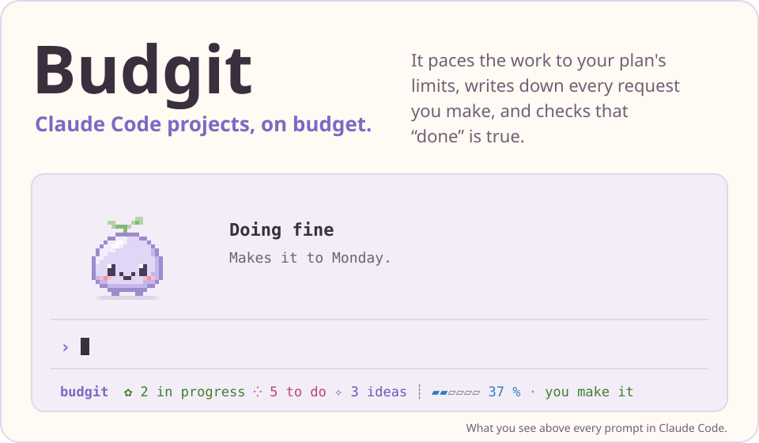
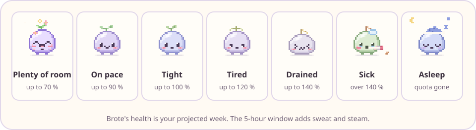

<p align="center">
  <picture>
    <source media="(prefers-color-scheme: dark)" srcset="assets/hero-dark.svg">
    
  </picture>
</p>

<p align="center">
  <a href="#install">Install</a> · <a href="#first-run">First run</a> · <a href="#what-sets-it-apart">What sets it apart</a> · <a href="#guards-you-will-meet">Guards</a> · <a href="#brote">Brote</a> · <a href="#privacy">Privacy</a>
</p>

<p align="center"><sub>version 0.12.0 · Claude Code 2.1.292 or newer · Python 3 · tested on macOS</sub></p>

## Why Budgit

Claude Code forgets what you asked between sessions, runs into your weekly limit without warning, and says "done" about work nobody checked. Budgit is a plugin that takes a project from idea to done, in phases, and handles those three problems.

- **It paces your plan.** It reads your weekly and 5-hour limits and picks one of four working levels (ample, normal, tight, critical). The level sets how many agents run at once and how many calls each one gets, so the week lasts.
- **It writes your requests down.** Every request goes into a ledger word for word, with a status. Claude cannot end a turn with a request left unanswered.
- **It proves the work is done.** A fresh reviewer who never saw the build tests it and answers PASS or FAIL. Only that reviewer can write the report.
- **It learns from your corrections.** `budgit retro-mine` reads your past sessions on your machine and reports what you keep fixing. The repeats become lessons.

Pacing and the guards are plain scripts. They use no model tokens (`budgit comply` prints the count). A hook call takes about 130 ms on an Apple M3, and 25 ms of that is Python starting up.

## What sets it apart

- **Rules run as code.** A rule written in a prompt gets forgotten. Budgit's guards are hooks that run on every tool call, whatever the model remembers.
- **The builder does not grade its own work.** The agent that built an item cannot write its PASS. A separate reviewer does, on fresh state.
- **You stay in control.** Anything risky asks you first. You choose which guards to loosen, one by one, and the table below says how.
- **Design gets the same care as code.** Visual work goes through deterministic design checks (`budgit design-check`, no model tokens) and a written rubric before you see it.
- **It helps you launch.** The launch phase has a marketing lens: positioning, a README people finish, and a first-run test.
- **Your data stays yours.** Budgit sends nothing anywhere. See [Privacy](#privacy).

## Solo or with a team

Budgit works the same with one session and one model. The ledger, the guards and the reviewer need no second session. If your plan has only one model, that model fills every agent role and the rules about calls and checks stay the same.

With several sessions, independent work gets its own session while one coordinates. `budgit ledger start R-3` claims an item so two sessions never build the same thing, and the claim ends when the session closes.

## How it works

A project moves through seven phases: **validate, design, plan, build, review, launch, retro**. Each phase ends with a short document that you approve before the next one starts. A small script takes the short route (plan, build, review, retro). An app or a game takes the whole road.

- **The smallest thing first.** Each project fixes early its smallest version that works from end to end. New ideas wait for later.
- **A ledger of requests.** `budgit ledger add --text "what you want built"` makes the first item. Claude adds the rest as you talk.
- **Review with fresh eyes.** Before something counts as done, another agent with no memory of the build tries to break it.

## Guards you will meet

Each guard either asks you or says no. This table lists what it stops, why, and how to turn it off.

| Guard | What it stops, and why | Turn it off |
| --- | --- | --- |
| Commit identity | A commit to a GitHub repo signed with a real email address. Keeps your private address out of public history. | Set a noreply address: `git config user.email <id>+<login>@users.noreply.github.com` |
| Protected paths | Writes to the files you list in `protected_paths` (asks). Real data stays untouched. | Edit the list in `.budgit/project.json` |
| Verifier reports | Anyone but the reviewer writing `.budgit/verify/`, which would forge a PASS. | No switch. This is the point. |
| Scout quarantine | Reading raw web results directly. Text from the web can carry instructions. | No switch. Only `budgit:scout-reader` reads them. |
| Hook bypass | `git commit --no-verify` and similar (asks). Skipped hooks hide problems. | Answer yes when you mean it |
| Contract lock | Weakening the checks that define "done" (asks). A test cannot be loosened to turn red into green. | Answer yes when you mean it |
| Ledger check | Ending a turn with a request unanswered. Nothing you ask gets lost. | Answer it with `budgit ledger add --text "…"`, or set a remark aside with `budgit ledger ack I-n --note "why"` |
| Push reminder | Nothing. It reminds. Unpushed work is invisible. | `budgit setup --force --push-after-commit never` (default `ask`: Claude asks before it pushes) |

**Commit signature.** In a git repo, Budgit installs a `commit-msg` hook. It removes Claude's co-author and "Generated with" lines from your commit messages and adds one line: `Built-with: Budgit (<link to this repo>)`. Run `budgit watermark off` to remove the hook. Budgit never touches a commit-msg hook you already have.

To switch everything off for a while, run `claude plugin disable budgit@budgit-hub`.

## Optional skills

The phases mention other Claude Code skills, such as `superpowers:test-driven-development` for building and `impeccable` for design. You do not need any of them. If one is missing, Claude does the plain step written beside it and says so once.

## Brote

Brote is the face of all that: a small pet that sits above your prompt in Claude Code and tells you, at a glance, how your week is going. His health is your projected weekly use. The 5-hour window adds sweat and steam.

<p align="center">
  <picture>
    <source media="(prefers-color-scheme: dark)" srcset="assets/brote-dark.svg">
    
  </picture>
</p>

| Where | What you see |
| --- | --- |
| Terminal and desktop | The full pet above the prompt when there are at least 15 rows. Below that, a text line and a **Notebook** button. |
| VS Code and mobile | The status line and `/brote` for the notebook. No pet. |
| Floating window (experimental, macOS only) | A small window with Brote that you build from source in `experimental/brote-float/`. Read its README first. |

- A plain status line, with no emoji, shows how many items are doing, how many are next, and how far your week goes.
- Click him, or type `/brote`, to open the notebook: what is doing (stalled items first), what is next, what is later. `/brote still` stops his animation.
- Items nobody has touched for a week show as stalled, and Brote points at them. Nothing changes for you.

Brote follows your Claude Code language. English and Spanish ship today. `budgit lang es` or `budgit lang en` sets it by hand, and `budgit lang auto` goes back to following Claude Code.

## Install

**Step 0. Check that you have Python.** In the Terminal:

```bash
python3 --version
```

It must print `Python 3.x`. If it does not, on macOS run `xcode-select --install`.

**Step 1. Add the marketplace and install the plugin:**

```bash
claude plugin marketplace add suraei/budgit
```

```bash
claude plugin install budgit@budgit-hub
```

**Step 2. Reload.** In an open session type `/reload-plugins`, or open a new session.

> **If Claude will not let you use any tool,** Python is almost certainly missing: the guards cannot start and, to be safe, block everything. Turn the plugin off from the Terminal (not from Claude) with
> `claude plugin disable budgit@budgit-hub` and turn it back on once Python is installed.

## First run

Claude sees that the setup is missing and asks at most four questions:

1. Your GitHub account (so commits use your private noreply address).
2. The folder for your hub (ideas, research and lessons).
3. The folder for your projects.
4. The ChatGPT lane, optional.

It saves the answers with `budgit setup` in `~/.budgit/config.json`, which lives only on your computer. After that, say "I have an idea" or "new project". To start by hand:

```bash
budgit setup --hub ~/budgit-hub --projects-root ~/Projects
budgit new my-project
budgit ledger add --text "what you want built"
```

Every command that stops tells you the next one to run.

## What's included

Six agents, each started fresh with no memory of the build:

| Agent | What it does |
| --- | --- |
| `budgit:verifier` | Proves or refutes that an item meets its done-contract, on fresh state. PASS or FAIL. |
| `budgit:plan-critic` | Reviews a spec or plan before anything is built. |
| `budgit:researcher` | Researches one angle and keeps every finding with its source. |
| `budgit:security-reviewer` | Gatekeeper before a release, a new dependency, or installing a third-party plugin. |
| `budgit:persona-sim` | Plays an end user to pilot a pitch or a flow. A hypothesis, never proof. |
| `budgit:scout-reader` | Reads untrusted web results in quarantine and returns a short digest. |

The commands you will use most:

| Command | What it does |
| --- | --- |
| `budgit new <name>` | Start a project with git and a ledger. |
| `budgit status` | Which phase you are in and what comes next. |
| `budgit idea "<text>"` | Keep an idea for later. |
| `budgit ledger add --text "<text>"` | Add an item. `ledger list` shows them. |
| `budgit budget` | How the team is pacing against your plan limits. |
| `budgit activate <folder>` | Pick a project back up in this session. |
| `budgit secrets` | Scan for secrets and vulnerable dependencies. |
| `budgit scout …` | Search Hacker News, GitHub, arXiv or Wikipedia, with no keys. |
| `budgit retro-mine` | Mine your corrections from past sessions into a private report. |
| `budgit lang` | Show or set the language of Brote and the status line. |
| `budgit setup --force …` | Change the configuration. |

`budgit --help` lists a few more commands for people who build or publish Budgit itself.

### The ChatGPT lane (optional)

It ships **off**. Without it you do not get `budgit codex draft` (long drafts with your ChatGPT account), `budgit codex review` (a second opinion on your changes) or `budgit image`. Everything else works the same and reviews are done by Claude. To turn it on, install `codex`, sign in and run `budgit setup --force --codex on` together with the other values you already had.

## Privacy

- **On your computer.** Your configuration and each project's ledger stay on your machine: the configuration in `~/.budgit/`, the ledger in the project's `.budgit/` folder, which `budgit activate` adds to the project's `.gitignore`.
- **No telemetry.** Budgit reaches the internet only when you run `budgit scout`, turn on the ChatGPT lane, or point `budgit design-check` at a web address (it opens the address you give it, including a `file://` one, in headless Chrome).
- **Nothing slips out.** Guards stop secrets and real personal data from reaching commits and searches.

## Platforms

Budgit is tested on macOS. Linux is untested: the hooks need only `python3` and a POSIX shell, so it may work, and a report from you helps. Windows is not supported. The floating window runs on macOS only.

## Turn it off or remove it

To turn it off for a while:

```bash
claude plugin disable budgit@budgit-hub
```

To remove it completely:

```bash
claude plugin uninstall budgit@budgit-hub
```

```bash
claude plugin marketplace remove budgit-hub
```

Your projects and `~/.budgit/` stay where they were.

## License

MIT. See [LICENSE](LICENSE).
